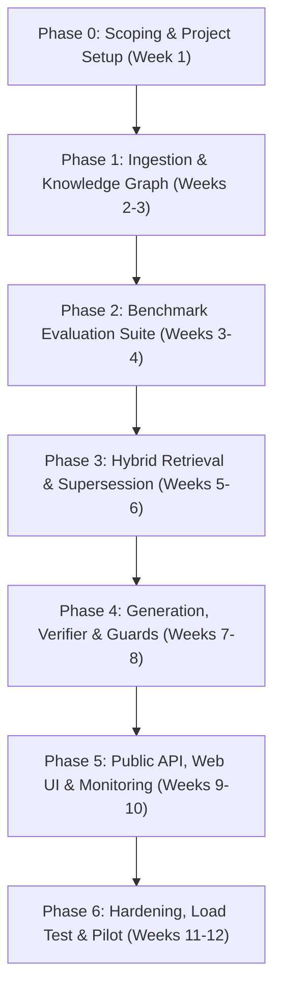

# Anupalan: Engineering & Implementation Guide

**Production Implementation Blueprint for Multilingual, Citation-Grounded Compliance Navigator (RAG System)**

| Attribute | Specification |
| :--- | :--- |
| **System Name** | Anupalan (`અનુપાલન` / `अनुपालन`) |
| **Repository** | `https://github.com/vedakoshiya/anupalan` |
| **Architecture** | Monorepo Modular Packages + Microservices |
| **Python Target** | Python 3.12+ |
| **Frameworks** | FastAPI, Pydantic v2, PostgreSQL 16 + pgvector, OpenSearch / Postgres FTS |
| **Target Languages**| Gujarati (`gu`), Hindi (`hi`), English (`en`), Transliterated Gujlish / Hinglish |

---

## 1. System Architecture & Module Boundaries

The project is structured into standalone, testable Python packages under `packages/`, deployable services under `services/`, and evaluation/infrastructure runners.

```
anupalan/
├── .github/workflows/          # CI/CD, linting, evaluation gates
│   ├── ci.yml                  # Unit tests, formatting, type checking
│   └── eval-gate.yml           # Golden-set regression gates for PRs
├── config/                     # Configuration files (YAML, non-sensitive)
│   └── default.yaml
├── data/                       # Local data mount (Ignored from git)
│   ├── raw/                    # Raw PDFs, HTML, official circulars
│   ├── processed/              # OCR text, structured JSONs
│   └── fixtures/               # Test fixtures for unit/integration tests
├── db/                         # Database migrations and seed scripts
│   ├── migrations/             # Alembic / SQL migrations
│   └── seeds/                  # Seed scripts for initial glossary & taxonomy
├── docs/                       # Specifications, ADRs, and runbooks
│   ├── SPECIFICATION.md        # Canonical PRD & SRS specification
│   ├── IMPLEMENTATION.md       # This implementation manual
│   ├── ADRs/                   # Architectural Decision Records
│   └── runbooks/               # Ingestion, reindexing, and outage runbooks
├── eval/                       # Benchmark datasets and evaluation engines
│   ├── datasets/               # Golden set (250 questions), temporal, adversarial
│   ├── run_retrieval_eval.py   # Retrieval metrics: Recall@5, MRR, nDCG
│   └── run_generation_eval.py  # Generation metrics: Faithfulness, Citations, Numbers
├── infra/                      # Deployment and cloud configuration
│   ├── docker/                 # Dockerfiles & docker-compose.yml
│   └── terraform/              # Infrastructure-as-code for India region deployment
├── packages/                   # Core business logic packages
│   ├── adapters/               # Provider-agnostic adapters (LLM, Embedder, OCR)
│   ├── generation/             # Prompt orchestration, JSON schemas, Verifier, Numeric guard
│   ├── query/                  # Lang-ID, Transliteration, Glossary, Intent, Temporal parsing
│   └── retrieval/              # Hybrid search (RRF), Reranker, Supersession graph, Expansion
├── services/                   # Deployable services
│   ├── admin/                  # Curator UI backend (OCR review, glossary CRUD)
│   ├── api/                    # Public FastAPI application (`/v1/ask`, `/v1/feedback`)
│   └── ingestion/              # Scrapers, OCR workers, parser, chunker, indexers
├── tests/                      # Automated test suite
│   ├── unit/                   # Unit tests per package
│   └── integration/            # End-to-end integration tests
├── web/                        # Lightweight React/Next.js client interface
├── .env.example                # Safe environment variable template
├── .gitignore                  # Security-first ignore rules
├── LICENSE                     # Open source license (Apache-2.0)
├── pyproject.toml              # Build system, workspace definitions, dependencies
└── README.md                   # Repository landing page
```

---

## 2. Core Packages Implementation Details

### 2.1 `packages/query` (Query Understanding & Normalization)
* **Goal:** Transform noisy, vernacular, or mixed Gujlish/Hinglish queries into structured search requests with temporal awareness.
* **Key Components:**
  1. `language_detector.py`: Detects script and language (`gu`, `hi`, `en`, or transliterated Gujlish).
  2. `transliteration_normalizer.py`: Standardizes colloquial phonetic spellings (e.g., *"dedh lakh"* $\rightarrow$ `1,50,000`, *"kevi rite"* $\rightarrow$ standard Gujarati token).
  3. `glossary_expander.py`: Uses the `glossary` table to map vernacular terms to official regulatory terminology (e.g., *"job work"*, *"ITC / input tax credit"*, *"composition limit"*).
  4. `temporal_resolver.py`: Parses relative time expressions (e.g., *"aa varsh"*, *"last financial year"*, *"1 April 2024 thi"*) into an exact `as_of` date (`YYYY-MM-DD`). Defaults to current date if unspecified.
  5. `intent_classifier.py`: Routes query into: `rule_lookup`, `scheme_eligibility`, `procedure`, `deadline`, `out_of_scope`, `chit_chat`.
  6. `decomposer.py`: Breaks complex multi-clause questions into independent search sub-queries.
  7. `slot_filler.py`: Detects missing mandatory slots (turnover tier, state, goods vs services) and formulates interactive clarification prompts (max 2 turns).

### 2.2 `packages/retrieval` (Hybrid Search & Legal Version Graph)
* **Goal:** Retrieve the exact legal clauses in force on the target `as_of` date with high recall.
* **Key Components:**
  1. `hybrid_retriever.py`:
     - Lexical search using BM25 / PostgreSQL Full-Text Search.
     - Dense semantic search using 1024-dimensional multilingual embeddings.
     - Merges candidates using **Reciprocal Rank Fusion (RRF)**:
       $$RRF(d) = \sum_{m \in M} \frac{1}{k + r_m(d)} \quad (k=60)$$
     - Gathers top 50 candidates.
  2. `metadata_filter.py`: Pre-filters chunks by jurisdiction (`central` vs `gujarat`) and ensures `effective_from <= as_of AND (effective_to IS NULL OR effective_to > as_of)`.
  3. `reranker.py`: Employs a cross-encoder model (`BAAI/bge-reranker-v2-m3`) to re-score the top 50 candidates down to the top 8 most relevant passages.
  4. `supersession_resolver.py`: Traverses the `instrument_relations` graph. If a retrieved clause was amended by a subsequent notification valid on `as_of`, it pulls the amending text and demotes or annotates the legacy clause.
  5. `parent_expander.py`: When a retrieved chunk is a subsection or proviso referencing definitions, it automatically includes surrounding parent context.
  6. `confidence_gate.py`: Computes confidence based on top rerank scores and score margins. If confidence falls below threshold $\theta$, routes query directly to the **Abstention Path**.

### 2.3 `packages/generation` (Structured Synthesis, Verifier & Guards)
* **Goal:** Generate factual, citation-grounded answers while preventing hallucination and enforcing legal accuracy.
* **Key Components:**
  1. `prompt_engine.py`: Constructs prompt with system guardrails, retrieved chunks with contextual headers, and language matching rules.
  2. `schemas.py`: Pydantic models for structured output:
     ```python
     class Citation(BaseModel):
         chunk_id: UUID
         instrument: str
         clause: str
         effective_from: date

     class Claim(BaseModel):
         text: str
         citations: list[Citation]
         confidence: float

     class StructuredAnswer(BaseModel):
         summary: str
         claims: list[Claim]
         next_steps: list[str]
         language: str
         as_of: date
         corpus_updated: date
         disclaimer: str
     ```
  3. `verifier.py` (Citation Enforcement):
     - An independent verification pass (Natural Language Inference or dedicated verifier LLM call).
     - Checks if each claim $C_i$ is logically entailed by its cited passage $P_i$.
     - Unsupported claims are stripped or trigger re-generation.
  4. `numeric_guard.py`:
     - Extracts all numbers, monetary limits, GST rates, and dates from generated claims.
     - Asserts that every number appears verbatim (or normalized equivalent) within the cited source chunks.
     - Strips any answer with ungrounded numeric values.
  5. `abstention_engine.py`: Pre-built empathetic, clear abstention and escalation messages in Gujarati, Hindi, and English.

### 2.4 `packages/adapters` (Provider-Agnostic Interfaces)
* **Abstract Base Classes:**
  - `BaseLLMAdapter`: `generate(messages, schema, temperature) -> dict`
  - `BaseEmbedderAdapter`: `embed_documents(texts) -> list[list[float]]`, `embed_query(text) -> list[float]`
  - `BaseRerankerAdapter`: `rank(query, passages) -> list[RerankResult]`
  - `BaseOCRAdapter`: `extract_text_and_layout(file_bytes) -> ExtractedDocument`
* **Implementations:**
  - Gemini / OpenAI adapters for LLM generation.
  - HuggingFace / Local BGE-M3 adapter for embeddings & reranking.
  - Tesseract / Document-AI adapter for layout-aware OCR.

### 2.5 `services/ingestion` (Data Harvesting, Layout OCR & Graph Extractor)
* **Components:**
  1. `connectors/`: Crawlers for CBIC, GST Council, Gujarat Commercial Tax, MSME portal.
  2. `ocr_pipeline/`: OCR with confidence scores per page. Pages scoring $< 0.85$ route to `curator_review_queue`.
  3. `layout_parser/`: Preserves tables as structured markdown/JSON rows, separates clauses, headings, and provisos.
  4. `chunker.py`: Structure-aware clause chunking (**200 to 500 tokens**) with prepended metadata header:
     `[Authority: CBIC | Instrument: Notif 12/2024-CT | Section: Para 3(b) | Subject: Job Work]`.
  5. `version_graph_builder.py`: Extracts and populates `instrument_relations` (`amends`, `supersedes`, `clarifies`).

### 2.6 `services/api` (FastAPI Application)
* **Endpoints:**
  - `POST /v1/ask`: Main Q&A endpoint.
  - `GET /v1/instruments/{id}`: Detailed metadata & amendment timeline.
  - `GET /v1/chunks/{id}`: Passages with visual bounding boxes for PDF rendering.
  - `POST /v1/feedback`: User satisfaction ratings and reason codes.
  - `GET /v1/health`: Corpus freshness, DB connectivity, index status.

---

## 3. Step-by-Step Implementation Roadmap



### Phase 0: Scoping, Setup & Data Taxonomy (Week 1)
- [x] Repository initialization with standard open-source structure.
- [x] Security-first `.gitignore` and `.env.example`.
- [x] Database migration schemas (`instruments`, `chunks`, `instrument_relations`, etc.).
- [x] Select initial 40 core instruments (GST Job Work, Composition Scheme, Udyam Registration, Gujarat MSME Capital Subsidy).
- [x] Initialize domain glossary seed with ~100 common Gujlish/Hindi tax terms.

### Phase 1: Ingestion Pipeline & Version Graph (Weeks 2–3)
- [x] Implement PDF and scanned document ingestion with OCR confidence scoring.
- [x] Build layout parser for clause-level and tabular chunking.
- [x] Implement `instrument_relations` graph builder to track amendment chains.
- [x] Store raw documents immutably in S3/MinIO with cryptographic SHA-256 hash.

### Phase 2: Evaluation Benchmark Suite (Weeks 3–4)
- [x] Curate golden evaluation dataset with ground-truth citations.
- [x] Curate temporal dataset (evaluating changes across `as_of` dates).
- [x] Curate adversarial questions (false premises, out-of-scope tax computations, prompt injection).
- [x] Implement offline evaluation runners (`run_retrieval_eval.py`, `run_generation_eval.py`, `eval_gate.py`).

### Phase 3: Hybrid Retrieval & Supersession Engine (Weeks 5–6)
- [x] Implement BM25 lexical indexing and pgvector dense embedding index.
- [x] Implement Reciprocal Rank Fusion (RRF) for candidate retrieval.
- [x] Integrate cross-encoder reranker (`bge-reranker-v2-m3` adapter interface).
- [x] Implement temporal pre-filtering and supersession resolution graph traversal.
- [x] Validate retrieval Recall@5 $\ge$ 0.90 against the golden dataset (achieved Recall@5 = 1.000).

### Phase 4: Generation, Verifier & Guardrails (Weeks 7–8)
- [x] Implement structured JSON prompt generation with Pydantic output schemas.
- [x] Build NLI/entailment citation verifier to check each claim against cited passages.
- [x] Implement strict Numeric Guardrail (validating numbers, percentages, dates, and vernaculars).
- [x] Implement Abstention Engine for low-confidence, out-of-scope, and ambiguous queries.
- [x] Validate Faithfulness $\ge$ 0.95 and Hallucinated Numbers $< 1\%$ (achieved 0.00% hallucinations).

### Phase 5: API, Web Client & Operational Observability (Weeks 9–10)
- [x] Implement FastAPI endpoints (`/v1/ask`, `/v1/instruments/{id}`, `/v1/chunks/{id}`, `/v1/feedback`, `/v1/health`, `/v1/sessions/{id}`, `/v1/telemetry/purge`, `/metrics`).
- [x] Implement DPDP-compliant telemetry (`PIIScrubber` for PAN/GSTIN/Aadhaar/Phone/Email, 30-day rolling TTL `AuditLogStore`, Section 12 Right to Erasure).
- [x] Develop responsive web interface (`web/index.html`, `web/styles.css`, `web/app.js`) with citation inspection, visual bounding box simulation, vernacular chips, and DPDP purge button.
- [x] Integrate Prometheus metrics (`PrometheusMetricsCollector`) tracking HTTP traffic, p95 latencies, answers generated, user feedback ratings, and DPDP purges.
- [x] 100% test pass rate (138/138 tests passing, 94% coverage, CI gate 1.000 Recall@5 / 0.00% hallucinations).

### Phase 6: Hardening, Load Testing & Pilot (Weeks 11–12)
- [ ] Conduct burst load testing (20 QPS burst, verify p95 latency $< 8s$).
- [ ] Run ablation studies (BM25 vs Dense vs Hybrid, Verifier ON vs OFF).
- [ ] Pilot with 3–5 practicing accountants and 10 MSME owners in Surat/Gujarat.
- [ ] Document final performance report and operational runbooks.

---

## 4. Security, DPDP Compliance & Privacy Guarantees

In an open-source regulatory platform, privacy and security must be mathematically and architecturally guaranteed:

1. **Zero Secret Leakage:**
   - `.gitignore` strictly rejects `.env*`, `.pem`, `secrets/`, `credentials.json`, and database dumps.
   - GitHub Actions CI runs `gitleaks` or `trufflehog` on every push to detect accidental secret commits.
2. **DPDP Act (2023) Alignment:**
   - User queries and conversation logs are capped at a **30-day rolling TTL**.
   - Automatic PII scrubbers (regex & NER) redact PAN numbers, GSTINs, phone numbers, and names prior to logging.
   - Users are provided with clear consent notices and single-click data deletion.
3. **Data Residency:**
   - Cloud resources, databases, and embedding indexes must reside in AWS/GCP **India region** (`ap-south-1` / `asia-south1`).
4. **Prompt Injection Hardening:**
   - Retrieved circulars are wrapped in XML-escaped data tags (`<context_document>`).
   - System prompts enforce strict separation: user prompts and documents are treated strictly as reference data, never as executable instructions.

---

## 5. Developer Quickstart

### Prerequisites
- Python 3.12+
- Docker and Docker Compose
- PostgreSQL 16 with `pgvector`

### Environment Setup
```bash
# 1. Clone repository
git clone https://github.com/vedakoshiya/anupalan.git
cd anupalan

# 2. Create virtual environment
python -m venv .venv
source .venv/bin/activate  # On Windows: .venv\Scripts\activate

# 3. Install dependencies in editable mode
pip install -e ".[dev]"

# 4. Copy environment template
cp .env.example .env
# Edit .env with your local credentials and API keys

# 5. Start infrastructure (Postgres, pgvector, MinIO)
docker compose -f infra/docker/docker-compose.yml up -d

# 6. Apply database migrations
alembic upgrade head

# 7. Run test suite
pytest tests/unit
```
